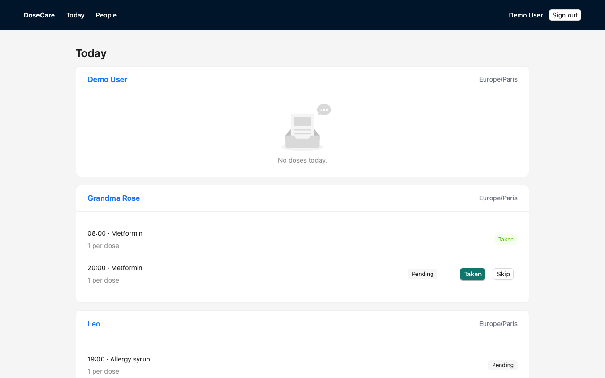
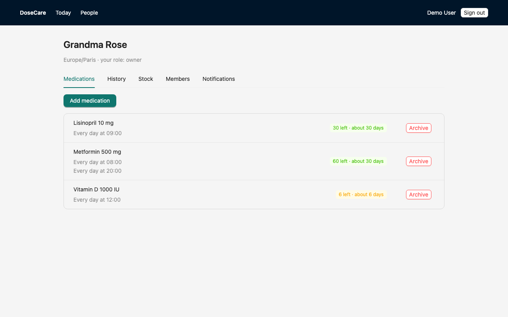
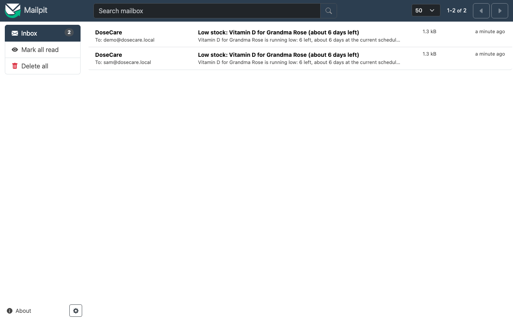
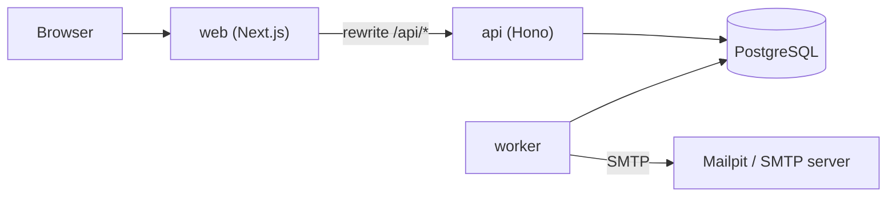

# DoseCare

DoseCare is a medication tracking and reminder platform. You track your own treatments and those of relatives, share access with caregivers, get email reminders, and caregivers are alerted when a dose is missed or a stock is running low. It is a portfolio project: a complete stack (PostgreSQL, REST API, background worker, web app) that starts with one command and uses fictional data only.

> **Not medical advice.** DoseCare is a demonstration project. It does not give medical advice, diagnosis or dosing guidance, and must not be relied on for real treatment decisions.





## Quick start

Requires Docker with Compose.

```bash
docker compose up --build
```

| What | URL |
|---|---|
| Web app | http://localhost:3100 |
| API docs (spec at `/openapi.json`) | http://localhost:4000/docs |
| Mailpit (emails sent by the worker) | http://localhost:8026 |
| PostgreSQL | `localhost:5440` (user, password and database: `dosecare`) |

Sign in with `demo@dosecare.local` / `demo-password-123` (or `sam@dosecare.local`, same password). The stack seeds fictional people, a week of dose history and a nearly empty Vitamin D stock, so a low-stock email shows up in Mailpit within about a minute.

The host ports are deliberately not the usual defaults (3000, 5432, 1025 SMTP, 8025) so the stack does not collide with other local projects. Change them in `docker-compose.yml` if you need to. All ports are bound to `127.0.0.1`.

The demo seed (`SEED_DEMO=1` in `docker-compose.yml`) creates accounts with a known password. It is for local demos only: never expose this stack to a network or reuse the image on a reachable host.

## What it demonstrates

- **Relationship-based authorization**: roles `owner > editor > viewer` per followed person. Non-members get 404, never 403. A table-driven matrix test covers every route by role, and fails when a route is added without a matrix row.
- **DST-safe scheduling**: schedules are local times in the person's time zone, expanded to UTC instants with dedicated tests for DST gaps and overlaps.
- **Idempotent outbox with `SKIP LOCKED`**: notifications are enqueued by set-based SQL with a unique dedupe key, and dispatched by workers that claim rows with `FOR UPDATE SKIP LOCKED`. Final updates are fenced on the claimed attempt, and delivery is at-least-once.
- **Atomic dose recording**: the status change and the stock movement happen in one transaction, and a dose can only be closed once.
- **Stock ledger**: remaining stock is the sum of signed movements; no counter to drift.

## Architecture



Full description: [docs/ARCHITECTURE.md](docs/ARCHITECTURE.md). Decision records:

- [0001. Server-side sessions implemented in the API](docs/adr/0001-own-sessions.md)
- [0002. Postgres outbox as the job queue](docs/adr/0002-postgres-outbox.md)
- [0003. At-least-once email delivery](docs/adr/0003-at-least-once-delivery.md)
- [0004. Stock as a movement ledger](docs/adr/0004-stock-ledger.md)

The worker runs a cycle every `CYCLE_SECONDS` (10 s in Compose, 30 s by default): materialize upcoming doses, enqueue reminders, missed-dose alerts and low-stock alerts, then send what is due.

## Development

Requires Node 22 or newer (the Docker images use Node 22) and Docker.

```bash
npm install                      # or: npm ci
docker compose up -d postgres mailpit
npm test                         # unit and integration tests, real Postgres on localhost:5440
npm run typecheck
npm run lint
npm run e2e                      # Playwright smoke test against the full stack (see below)
SMTP_TEST=1 npm test -w @dosecare/worker -- smtp   # optional: SMTP delivery into Mailpit
```

Tests use Postgres on host port 5440 by default; set `TEST_ADMIN_DATABASE_URL` to use another server. `npm run e2e` needs the whole stack and Chromium: `docker compose up --build -d --wait` then `npx playwright install chromium` once.

Running the apps from source (copy the variables from `.env.example` into your environment first, for example `set -a; source .env.example; set +a`):

```bash
npm run dev -w @dosecare/api      # API on :4000 (runs migrations on start; SEED_DEMO=1 also seeds the demo data)
npm run dev -w @dosecare/worker   # worker, cycle every CYCLE_SECONDS (default 30)
npm run dev -w @dosecare/web      # web on :3100, proxies /api/* to API_URL (default http://localhost:4000)
```

Stop the Compose `api` and `web` containers first if you run them from source, as they use the same host ports. Environment variables are listed in `.env.example`; for the API, `TRUST_PROXY=1` makes the rate limiter use the rightmost `X-Forwarded-For` entry (the Next.js rewrite), so keep the API port private in production.

## Known limits

- No email verification and no password reset.
- Rate limiting is in memory, per API process.
- One API instance behind the web proxy; no hosted demo.
- The mobile app is planned, not built (the API already accepts bearer tokens for it).
- Tests need a real Postgres (`docker compose up -d postgres`); there is no in-memory fallback.

## Tech stack

TypeScript 6.0.3, Node 22, npm workspaces. API: Hono 4.13.13, Zod 4.6.7, Drizzle ORM 0.45.4, argon2id (`@node-rs/argon2` 2.2.2). Worker: nodemailer 10.1.2. Web: Next.js 16.4.2, React 19.3.1, Ant Design 6.6.6, Tailwind CSS 4.3.3, TanStack Query 5.104.3. Database: PostgreSQL 17. Tests: Vitest 5.0.5, Playwright 1.64.1. Email in development: Mailpit. CI: GitHub Actions.
