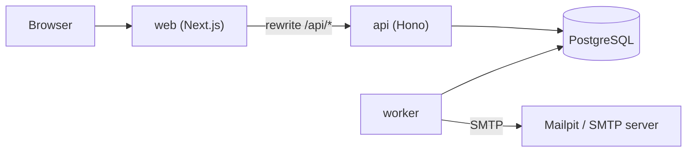

# Architecture

DoseCare is a TypeScript npm-workspaces monorepo: a Next.js web app, a Hono API, a background worker and two shared packages, around one PostgreSQL database. This document describes the code as it stands.

## Overview

The browser only talks to the web app. `apps/web/next.config.ts` rewrites `/api/:path*` to `API_URL` (`http://api:4000` in Compose), so the browser sees one origin and the session cookie is first-party. In production the web app is started by `apps/web/server.mjs`, which sets `X-Forwarded-For` to the connecting address (see Rate limiting below). The API and the worker never talk to each other: the API writes rows (for example invitation emails) into `notification_outbox`, and the worker reads them.

## Packages and apps

| Path | Role |
|---|---|
| `packages/shared` (`@dosecare/shared`) | Zod request schemas, the `Clock` abstraction (`SystemClock`, `FakeClock`), time-zone aware dose time computation (`doseTimesBetween`, `localDayStartUtc`, DST safe) and the `Role` type. |
| `packages/db` (`@dosecare/db`) | Drizzle schema, SQL migrations (`drizzle/`), `createDb`, `runMigrations`, the stock query `getStock`, and test database helpers. |
| `apps/api` (`@dosecare/api`) | Hono REST API: auth, recipients, members, invitations, medications, schedules, stock, doses, preferences, plus `/openapi.json` and `/docs`. Also holds the demo seed. |
| `apps/worker` (`@dosecare/worker`) | Periodic cycle: materialize doses, enqueue notifications, dispatch emails over SMTP (nodemailer). |
| `apps/web` (`@dosecare/web`) | Next.js App Router UI with Ant Design, Tailwind v4 and TanStack Query; uses a typed Hono client against the API. |
| `e2e/` | Playwright smoke test (`smoke.spec.ts`) and the on-demand screenshot script (`screenshots.spec.ts`). |

## Data model

Defined in `packages/db/src/schema.ts`.

| Table | Purpose |
|---|---|
| `users` | Account: unique email, argon2id `password_hash`, name. |
| `sessions` | `token_hash` (SHA-256 of the opaque token), `expires_at` (30 days), `revoked_at`. |
| `recipients` | A followed person: display name and IANA `time_zone`. |
| `recipient_members` | `(recipient_id, user_id)` primary key with `role` (`owner`, `editor`, `viewer`). |
| `invitations` | Invited email, role, `token_hash`, `expires_at` (7 days), `accepted_at`. |
| `medications` | Belongs to a recipient: name, strength, unit, `active`, optional start and end date. |
| `schedules` | Belongs to a medication: `days_of_week` (1 to 7), `time_of_day` (local time), `quantity_per_dose`, start and end date. |
| `dose_events` | One row per scheduled dose: `scheduled_at` (UTC), `status` (`pending`, `taken`, `skipped`, `missed`), `taken_at`, `recorded_by`. Unique on `(schedule_id, scheduled_at)`. |
| `stock_movements` | Ledger rows with signed `quantity` and `reason` (`refill`, `dose`, `adjustment`). |
| `notification_outbox` | Emails to send: `kind` (`reminder`, `missed_alert`, `low_stock`, `invitation`), JSON `payload`, unique `dedupe_key`, `status` (`pending`, `sending`, `sent`, `failed`), `attempts`, `next_attempt_at`, `locked_until`, `last_error`. |
| `notification_preferences` | Per recipient and user: reminders on or off (default off), missed alert on or off (default on) and its delay in minutes (default 30). |

Roles, as enforced by `requireRole` in `apps/api/src/authz.ts` (owner > editor > viewer):

| Action | viewer | editor | owner |
|---|---|---|---|
| Read medications, doses, stock | yes | yes | yes |
| Record a dose or stock movement | no | yes | yes |
| Create or edit medications and schedules | no | yes | yes |
| Manage members and invitations | no | no | yes |
| Rename, change time zone, delete the recipient | no | no | yes |

Any member can read and change their own notification preferences for a recipient.

Stock is a ledger: remaining quantity is the sum of `stock_movements.quantity`. A medication is `tracked` when it has at least one `refill` or `adjustment` movement (`getStock` in `packages/db/src/stock.ts`); until then doses write no movement and no low-stock alert is raised.

## API

`apps/api/src/app.ts` builds the Hono app (`createApp(deps)`): it puts `deps` (db, clock, app URL, cookie and proxy options) on the context, installs the error handler and a JSON 404, serves `/openapi.json` and `/docs`, and mounts the routers: `/auth`, three routers under `/recipients` (recipients, members, preferences) and three mounted at `/` (invitations, medications, doses).

- Authentication: `requireAuth` (`auth/middleware.ts`) reads the `sid` cookie or an `Authorization: Bearer` token, hashes it and looks up a non-expired, non-revoked session.
- Routers mounted at `/` scope `requireAuth` to their own prefixes (for example `/doses/*`) instead of `*`, so unknown paths still get the standard 404 rather than 401.
- Authorization: `requireRole(min, resolver)` resolves the recipient (from the path param, or via a medication, schedule or dose), loads the caller's membership and sets `role` and `recipientId` on the context. A non-member, a malformed id or an unknown id gets 404, never 403; a member below the minimum role gets 403.
- Validation: every JSON body and query goes through the `validator` wrapper in `apps/api/src/validate.ts`, which turns Zod failures into a 400 `invalid_request`.
- Errors: the body is always `{ error: { code, message } }` (`errors.ts`). Unexpected errors are logged and returned as a generic 500 `internal`.
- Rate limiting: `rate-limit.ts` is an in-memory sliding window per path and client, applied to failed logins (10 per 15 minutes; successful logins do not count) and registrations (50 per 15 minutes). With `TRUST_PROXY=1` the client key is the rightmost `X-Forwarded-For` entry. Next's external rewrite forwards request headers verbatim and never appends the client address, and neither `proxy.ts` nor a Route Handler can see the TCP peer, so the web app runs behind a tiny custom server (`apps/web/server.mjs`) that overwrites `X-Forwarded-For` with `req.socket.remoteAddress` before handing the request to Next. The API therefore always sees a value the web server set, never one the browser chose. Limits: anything in front of the web container (a load balancer, Docker Desktop's port forwarding) collapses its clients into one address, and direct access to the API port could spoof the header, so keep the API private in production.
- Startup (`server.ts`): runs migrations, runs the demo seed when `SEED_DEMO=1`, then serves.

### Request flow: take a dose

`POST /doses/:id/take` (`apps/api/src/routes/doses.ts`):

1. Global middleware attaches `deps`.
2. `requireAuth` (scoped to `/doses/*`) resolves the session to a user, or answers 401.
3. `requireRole('editor', fromDose)` looks up the dose's `recipient_id`, then the caller's membership: 404 for non-members, 403 for viewers.
4. In one database transaction: `UPDATE dose_events SET status='taken', taken_at=now, recorded_by=user WHERE id=? AND status IN ('pending','missed') RETURNING *`. No row means the dose was already recorded and the request fails with 409 `dose_not_open`, so double clicks and races record it once.
5. Still in the same transaction, a single `INSERT INTO stock_movements ... SELECT ... WHERE EXISTS (a refill or adjustment for this medication)` writes a `dose` movement of minus the dose quantity, only when stock is tracked.
6. The response is `{ id, status }`. Skip uses the same path without the stock movement.

## Worker

`apps/worker/src/main.ts` starts `createLifecycle`, which runs `runCycle` every `CYCLE_SECONDS` (default 30, 10 in Compose), logs one JSON line of counts per cycle and, on SIGTERM or SIGINT, waits for a running cycle and closes the pool. `runCycle` (`cycle.ts`) does, in order:

1. `materializeDoses`: for active medications, computes dose times from 60 minutes ago to 48 hours ahead in each recipient's time zone and inserts them with `ON CONFLICT DO NOTHING`.
2. `enqueueReminders`: pending doses that became due within the last 30 minutes, for members who enabled reminders.
3. `enqueueMissedAlerts`: pending or missed doses older than each member's alert delay (within 24 hours), for members who enabled the missed alert.
4. `markMissed`: pending doses more than 120 minutes past due become `missed` (they can still be recorded as taken later).
5. `enqueueLowStock`: tracked, active medications with 7 days or less of stock, for owners and editors; the dedupe key includes the last refill time, so one alert per refill cycle.
6. `dispatch` (`dispatch.ts`): sends due outbox rows.

Enqueue steps are set-based `INSERT ... SELECT ... ON CONFLICT (dedupe_key) DO NOTHING`, so running a cycle twice creates no duplicates.

Dispatch details:

- Crash-looping rows (status `sending`, lock expired, attempts at the maximum of 5) are marked `failed` first.
- Rows are claimed in one statement with `FOR UPDATE SKIP LOCKED` (batch of 20): `pending` rows that are due, plus `sending` rows whose `locked_until` (60 seconds) expired. The claim sets `status='sending'`, a new `locked_until` and `attempts = attempts + 1`.
- Each row is rendered and sent with the `dedupe_key` as the email Message-ID. The final update to `sent`, to `pending` (retry) or to `failed` is fenced on `status='sending' AND attempts=<claimed>`, so a late worker cannot overwrite a row that was reclaimed. Delivery is at-least-once.
- Retries use exponential backoff (30 s doubling, capped at 1 hour) with jitter; at the maximum attempts the row becomes `failed`.
- On success the `token` and `link` keys are removed from the stored payload, so invitation tokens do not stay in the table.

## Web

`apps/web/src/app`: `/login`, `/register`, `/invitations/[token]`, and an authenticated `(app)` group with `/today` (doses per followed person with Taken and Skip) and `/people` and `/people/[id]` (tabs: Medications, History, Stock, Members, Notifications). Data fetching uses TanStack Query and the typed client in `src/lib/api.ts`.

## Tests

Tests run against a real PostgreSQL (`docker compose up -d postgres`), by default at `localhost:5440`; `TEST_ADMIN_DATABASE_URL` overrides the admin connection. Tests create throwaway databases from a migrated template database (`createTestDb` in `packages/db/src/testing.ts`) and drop them afterwards.

| Command | What it runs |
|---|---|
| `npm test` | Vitest in every workspace (shared, db, api, worker, web). |
| `SMTP_TEST=1 npm test -w @dosecare/worker -- smtp` | The SMTP delivery test: sends through `localhost:1026` and checks Mailpit's API on `localhost:8026` (needs `docker compose up -d mailpit`). Skipped otherwise. |
| `npm run e2e` | Playwright smoke test against the running stack (`E2E_BASE_URL`, default `http://localhost:3100`). |
| `SCREENSHOTS=1 npx playwright test screenshots` | Regenerates `docs/img/*.png` from the demo account. |
| `npm run typecheck`, `npm run lint` | `tsc` per workspace, ESLint for the repo. |

## Adding a route

1. Add the handler in a file under `apps/api/src/routes/` and mount the router in `app.ts` if it is new. Use `requireAuth` (scoped to your prefixes), `requireRole(min, resolver)` and `validator(...)`.
2. Add a row to `MATRIX` in `apps/api/src/authz.matrix.test.ts` (method, pattern, minimum role, URL, body). Routes with no recipient role go in `NO_ROLE_ROUTES` instead. The test "every registered route is in the matrix or explicitly exempt" fails if you forget.
3. Add an entry to `ROUTE_DOCS` in `apps/api/src/openapi.ts` (summary, optional body or query schema). The test "documents every registered route" in `openapi.test.ts` fails if you forget.
4. Add behaviour tests next to the route.
